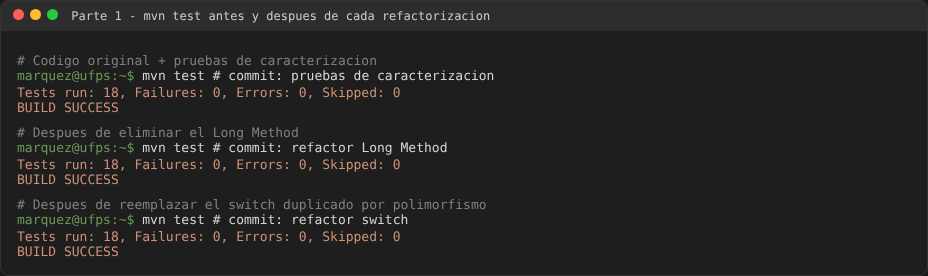
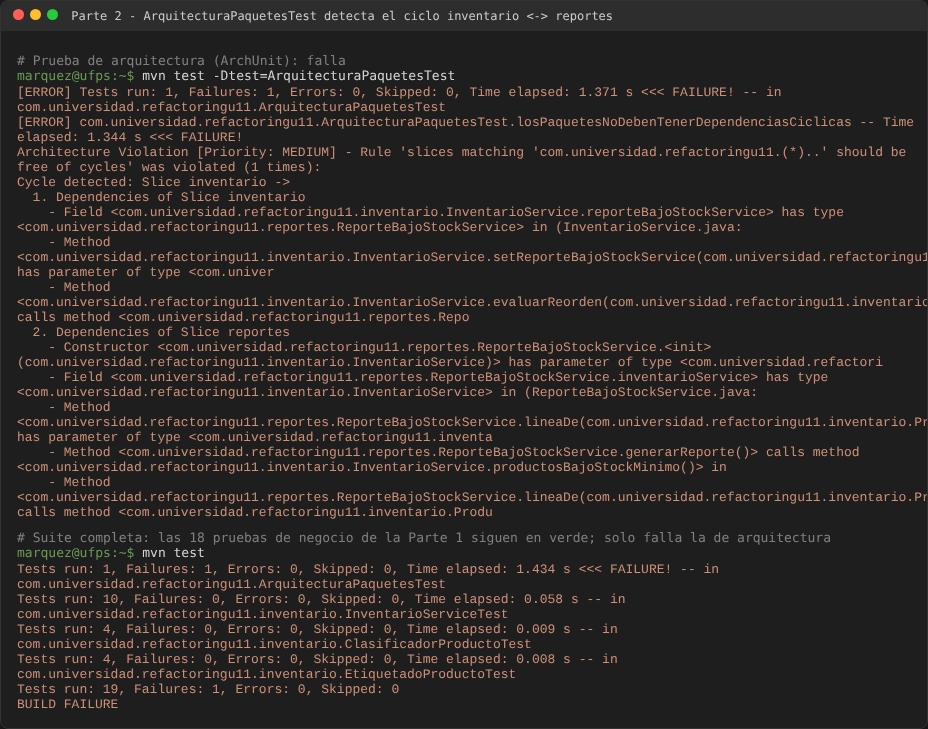
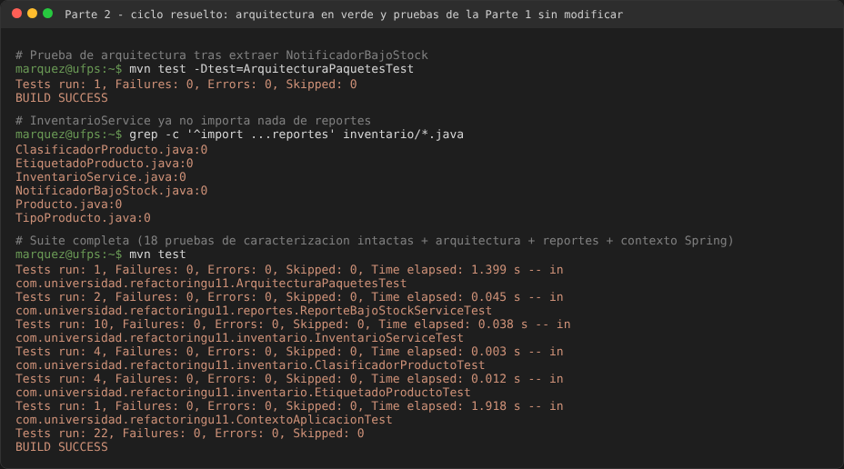

# Refactoring U11 — Refactorización Guiada por Pruebas

**Universidad Francisco de Paula Santander — Ingeniería de Sistemas**
**Curso:** Patrones de Diseño de Software (1156701-A) — Post-contenido Unidad 11
**Estudiante:** Diego Armando Márquez Rigaud — **Código:** 1152115

## Descripción

Proyecto Spring Boot (solo `spring-boot-starter`, Java 17) de inventario. En la **Parte 1** se escriben
pruebas de caracterización **antes** de tocar el código y se eliminan dos code smells reales (Long Method
y Switch Statements duplicados) con técnicas de Fowler elegidas de forma autónoma. En la **Parte 2** se
integra un módulo de reportes que introduce una dependencia cíclica entre paquetes; una prueba de
arquitectura con ArchUnit la detecta, se resuelve con inversión de dependencias y las pruebas de la Parte 1
se vuelven a ejecutar **sin modificarlas**.

```
src/main/java/com/universidad/refactoringu11/
├── RefactoringU11Application.java
├── inventario/   Producto, TipoProducto (enum polimórfico), InventarioService,
│                 ClasificadorProducto, EtiquetadoProducto, NotificadorBajoStock (abstracción)
└── reportes/     ReporteBajoStockService (implementa NotificadorBajoStock)
src/test/java/com/universidad/refactoringu11/
├── inventario/   InventarioServiceTest (10), ClasificadorProductoTest (4), EtiquetadoProductoTest (4)  ← caracterización
├── reportes/     ReporteBajoStockServiceTest (2)
├── ArquitecturaPaquetesTest (ArchUnit)  ·  ContextoAplicacionTest (@SpringBootTest)
```

## Parte 1 — Red de seguridad y refactorización guiada por evidencia

### Pruebas de caracterización (commit `test: agregar pruebas de caracterizacion antes de refactorizar`)

Se escribieron sobre el código original, sin Spring (`new InventarioService()`), y pasaron en verde antes de
cualquier cambio. Además de los casos del enunciado se agregaron casos límite: cantidad 0 y `productoId`
nulo, salida que deja el stock **exactamente** en el mínimo (no reordena), salida que deja el stock en 0 y
entrada que no alcanza el mínimo (también reordena), y las **cuatro** ramas de `generarEtiqueta` (el
enunciado solo traía dos). Total: 18 pruebas.

Verificación de que no se modificaron después: `git diff 4835de4 HEAD -- src/test/java/.../inventario/`
no muestra cambios.

### Evidencia antes / después (métricas reales de SonarQube 10.7 y conteo de líneas)

| Smell | Antes | Técnica aplicada | Después |
|---|---|---|---|
| **Long Method** — `actualizarInventario()` | **38 líneas**, CC **12**, complejidad cognitiva del archivo **13**; mezcla 5 responsabilidades: validación, búsqueda, actualización de stock, cálculo de reorden y registro/alerta | **Extract Method** (una responsabilidad por método con nombre que revela intención) + **Replace Loop with Pipeline** para la búsqueda | **11 líneas** (9 de cuerpo), CC **5**; complejidad cognitiva del archivo **8**; delega en `esSolicitudValida`, `buscarProducto`, `calcularNuevoStock`, `registrarMovimiento`, `evaluarReorden` y `calcularCantidadReorden` |
| **Switch Statements duplicados** | 2 × `switch (producto.getTipo())` con las mismas 4 ramas (`grep -c "case "` = 4 en cada clase); CC 5 en `ClasificadorProducto` y 5 en `EtiquetadoProducto` | **Replace Conditional with Polymorphism** con un enum que declara métodos abstractos (`recargoEnvio`, `etiqueta`) implementados por cada constante | 0 `switch`/`case` en ambas clases (CC 1 cada una); las firmas `calcularRecargoEnvio(Producto)` y `generarEtiqueta(Producto)` no cambiaron |

Se conservó deliberadamente un detalle del comportamiento original: una **ENTRADA** con cantidad negativa no
se valida contra stock negativo (el original solo lo verificaba en SALIDA). Cambiarlo habría sido corregir un
bug durante un refactor, algo que debe hacerse en un commit aparte y con su propia prueba.

Resultado de `mvn test` en cada paso (18 pruebas, todas en verde):



## Parte 2 — Diagnóstico y resolución de acoplamiento entre paquetes

### Diagnóstico: el ciclo

Al integrar `ReporteBajoStockService`, `InventarioService` pasó a importar `reportes` mientras `reportes`
ya dependía de `inventario`. Compila y las 18 pruebas de negocio siguen en verde —un code smell no es un
bug—, pero `ArquitecturaPaquetesTest` falla con *"Cycle detected: Slice inventario → reportes →
inventario"*:

```
ANTES (con ciclo)
 ┌──────────────┐   InventarioService ──▶ ReporteBajoStockService   ┌────────────┐
 │  inventario  │ ───────────────────────────────────────────────▶ │  reportes  │
 │              │ ◀─────────────────────────────────────────────── │            │
 └──────────────┘   ReporteBajoStockService ──▶ InventarioService    └────────────┘

DESPUÉS (sin ciclo)
 ┌───────────────────────────────────┐                             ┌────────────────────────────┐
 │ inventario                        │                             │ reportes                   │
 │  InventarioService ──▶ «interface»│ ◀────────────────────────── │  ReporteBajoStockService   │
 │                 NotificadorBajoStock                            │  implements Notificador... │
 └───────────────────────────────────┘   única dirección:          └────────────────────────────┘
                                          reportes → inventario
```



### Resolución

Se extrajo `NotificadorBajoStock` **en el paquete `inventario`**; `InventarioService` depende solo de esa
interfaz (por setter opcional, sin tocar el constructor que usan las pruebas) y `ReporteBajoStockService`
la implementa: registra cada alerta en `notificar(...)` y la incluye en `generarReporte()`, que además
consulta `InventarioService.productosBajoStockMinimo()`. `ArquitecturaPaquetesTest` pasa, `inventario` no
tiene ningún `import` de `reportes`, y la suite completa (22 pruebas) está en verde con las 18 pruebas de
caracterización intactas.

Detalle técnico encontrado al probar el contexto real de Spring: aunque el ciclo de **paquetes** desaparece,
en tiempo de ejecución sigue habiendo un ciclo de **objetos** (el notificador recibe `InventarioService` por
constructor e `InventarioService` recibe el notificador por setter). Spring Boot 3 prohíbe referencias
circulares por defecto, así que el parámetro del setter se marcó con `@Lazy` (se inyecta un proxy que se
resuelve en el primer uso). `ContextoAplicacionTest` (`@SpringBootTest`) confirma que el contexto arranca y que
una salida bajo el mínimo llega a `ReporteBajoStockService` a través de la abstracción.



## Decisiones de diseño

1. **Cálculo de reorden: método privado, no clase propia.** La regla es una sola expresión
   (`stockMinimo × 3 − stockActual`), depende solo de datos del producto, no necesita colaboradores, no se
   reutiliza en otro lugar y no hay hoy una segunda política que la haga variar. Una `CalculadoraReorden`
   sería generalidad especulativa: una clase más que inyectar (y que `new InventarioService()` tendría que
   construir con `new`) sin una razón de cambio distinta todavía. Quedó aislada en
   `calcularCantidadReorden(...)` con la constante `FACTOR_REORDEN`, de modo que extraerla es trivial
   (*Extract Class*) el día que aparezca una política por tipo de producto o por proveedor —esa sí sería una
   razón de cambio propia, del área de compras.
2. **Polimorfismo con enum de métodos abstractos, no interfaz de estrategia con una clase por tipo.** El
   conjunto de tipos es **cerrado y estable** en este dominio, y los comportamientos son funciones puras del
   precio o del nombre, sin dependencias. El enum mantiene juntas las dos variaciones de cada tipo y el
   compilador obliga a implementar ambos métodos al agregar una constante, así que es imposible olvidar uno
   (el riesgo original del switch duplicado). Agregar un tipo no toca `ClasificadorProducto` ni
   `EtiquetadoProducto`. La interfaz de estrategia con una clase por tipo sería preferible si cada tipo
   necesitara colaboradores inyectados por Spring (por ejemplo, una tarifa de envío leída de un servicio
   externo), porque las constantes de un enum no son beans; ese costo de 4 clases + registro no se justifica
   hoy.
3. **`NotificadorBajoStock` vive en `inventario`.** Según la regla de la sección 4.3 de la guía, *los paquetes
   de infraestructura dependen de dominio; dominio nunca depende de infraestructura*. Aquí `inventario` es el
   paquete de **mayor nivel de abstracción**: contiene las reglas del negocio (stock, reorden, tipos) y es
   estable, mientras que `reportes` es un mecanismo de salida que puede cambiar o multiplicarse (correo,
   tablero, cola de mensajes). Si la interfaz estuviera en `reportes`, `inventario` seguiría importando
   `reportes` y el ciclo persistiría. Ubicada en `inventario`, la flecha queda en una sola dirección:
   `reportes → inventario`.
4. **Granularidad: `notificar(Producto, cantidadReorden)` por evento.** La detección de bajo stock ocurre en
   un movimiento concreto y en ese instante se conoce el producto y la cantidad exacta a reordenar; notificar
   en ese punto no exige que `InventarioService` acumule estado ni decida cuándo "cerrar un lote", mantiene la
   interfaz mínima y permite que cada implementación decida qué hacer (`ReporteBajoStockService` acumula,
   otra podría alertar de inmediato). Preferiría una notificación por lote (`notificar(List<Producto>)`) en un
   proceso batch —por ejemplo un cierre diario o una importación masiva de movimientos—, donde enviar una
   alerta por producto saturaría al destinatario o a un servicio externo con costo por llamada.

## Cómo ejecutar

```bash
mvn test                                   # 22 pruebas
mvn test -Dtest=ArquitecturaPaquetesTest   # solo la prueba de arquitectura
```

## Herramientas utilizadas

- Java 17, Spring Boot 3.3 (starter), JUnit 5, ArchUnit 1.3
- SonarQube Community 10.7 (Docker) para medir complejidad antes/después
- Apache Maven, Git, GitHub

## Conclusiones

Las pruebas de caracterización convirtieron la refactorización en un proceso verificable: cada paso pequeño se
confirmó con las mismas 18 pruebas, que nunca se modificaron. Extract Method redujo `actualizarInventario()`
de 38 a 11 líneas y de CC 12 a 5, y el enum polimórfico eliminó el switch duplicado y el riesgo de olvidar un
tipo. La Parte 2 mostró que un diseño puede compilar y pasar todas sus pruebas de negocio y aun así estar
mal acoplado; solo una prueba de arquitectura hizo visible el ciclo. Invertir la dependencia con una
abstracción en el paquete de dominio lo resolvió sin cambiar el comportamiento observable, y probar el
contexto real de Spring reveló un detalle (el ciclo de objetos) que las pruebas unitarias no mostraban.
